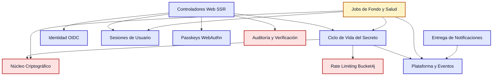
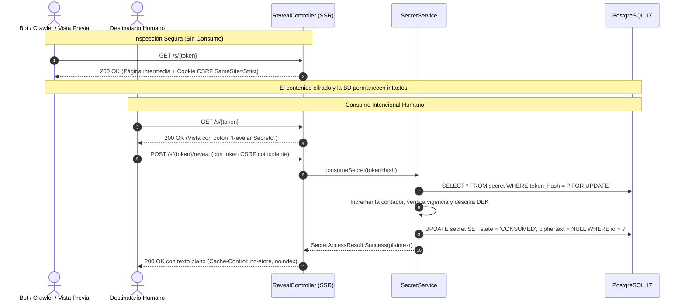
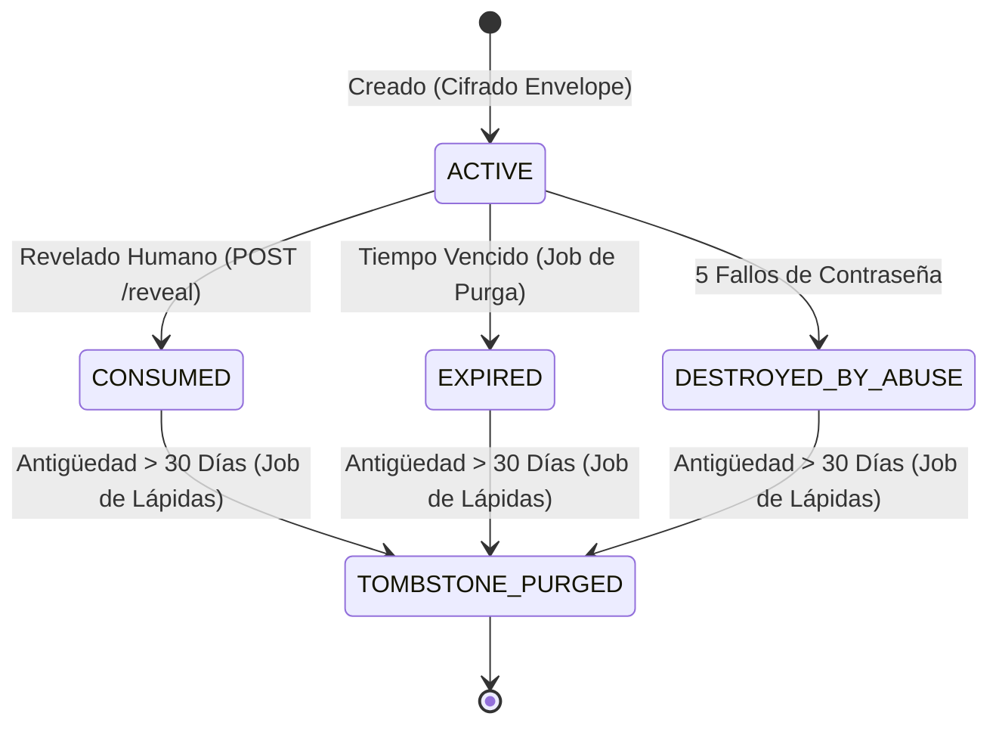

# 🔥 BurnBox

> **Compartición de secretos efímeros de nivel producción con seguridad en profundidad, cadena criptográfica de auditoría e higiene automatizada en segundo plano.**

[](https://openjdk.org/projects/jdk/25/)
[](https://spring.io/projects/spring-boot)
[](https://www.postgresql.org/)
[](src/test/java/com/burnbox/)
[](https://github.com/CharlyZeta/SDD-GL)
[](LICENSE)

[ **English** ](README.md) | [ **Español** ]

---

## ⚡ BurnBox en 30 Segundos

BurnBox es una aplicación web para compartir contraseñas, tokens de API y claves privadas mediante un enlace que se autodestruye. Vos entrás con tu cuenta de Google o Microsoft (o de forma anónima), escribís el secreto, elegís cuánto dura (de 5 minutos a 7 días) y cuántas visitas permite (de 1 a 10), y generás un link único de un solo uso. Cuando el destinatario lo abre una vez, el secreto se revela y su contenido cifrado se destruye permanentemente de la base de datos.

A diferencia de pastebins básicos o clones de Privnote, BurnBox está diseñado con seguridad de nivel empresarial: **cifrado envelope AES-256-GCM**, **derivación de contraseñas con Argon2id**, **passkeys WebAuthn FIDO2**, una **cadena criptográfica de auditoría inmutable con SHA-256**, **tareas de higiene distribuidas con ShedLock** y **rotación periódica de claves KEK en segundo plano**. Desarrollado con **Java 25 LTS** y **Spring Boot 3.5**.

---

## 🎯 ¿Qué Problema Resuelve?

1. **Elimina las fugas de credenciales en chats y correos:** Compartir contraseñas, claves de API o certificados por Slack, Microsoft Teams o email deja registros permanentes en texto plano en copias de seguridad de la nube, servidores de terceros y notificaciones móviles.
2. **Garantiza cero persistencia residual:** BurnBox asegura que el secreto exista únicamente hasta ser consumido o expirar; en ese instante, el texto cifrado, el nonce y las claves de descifrado se sobreescriben de forma atómica e irreversible con `NULL` en la base de datos.
3. **Ofrece cumplimiento y control de acceso verificable:** Permite restringir el acceso exclusivamente a un correo electrónico verificado, proteger secretos con contraseña secundaria Argon2id y auditar el historial de accesos mediante una cadena criptográfica a prueba de manipulaciones.

---

## 💼 Matriz de Capacidades Demostradas

| Capacidad | Implementación Técnica Destacada | Ubicación en el Código |
|---|---|---|
| **Seguridad Defensiva** | Cifrado envelope AES-256-GCM, KDF Argon2id, prevención de secuestro de cuentas anti-nOAuth, cuarentena de passkeys WebAuthn, registro criptográfico de auditoría, respuestas uniformes anti-enumeración. | [`com.burnbox.crypto`](src/main/java/com/burnbox/crypto/), [`com.burnbox.audit`](src/main/java/com/burnbox/audit/) |
| **Backend y Arquitectura** | Separación estricta de módulos con Spring Modulith, SQL explícito con Spring Data `JdbcClient` (cero problemas de dirty tracking de JPA), concurrencia no bloqueante con PostgreSQL 17 `SKIP LOCKED`, `ScopedValue` de Java 25. | [`com.burnbox.secret`](src/main/java/com/burnbox/secret/), [`ArchitectureTest`](src/test/java/com/burnbox/ArchitectureTest.java) |
| **Testing y Calidad** | 198 pruebas automatizadas, reglas arquitectónicas verificadas con ArchUnit, pruebas aisladas WebMvc y SpringBootTest, cero tests intermitentes, 100% First-Pass Quality Rate en 18 contratos. | [`src/test/java/com/burnbox`](src/test/java/com/burnbox/) |
| **Operación y Resiliencia** | Coordinación distribuida con ShedLock, rotación de KEK sin tiempo de inactividad, jobs de higiene de lápidas y sesiones, health indicators dedicados de Actuator sin fuga de secretos. | [`com.burnbox.ops`](src/main/java/com/burnbox/ops/) |

---

## 📊 Estado Real del Proyecto: Implementado vs Roadmap

Creemos en la transparencia técnica total:

### ✅ Listo y Verificado en Producción (18 Contratos Resueltos · 198 Tests)
- **Núcleo Criptográfico:** Tokens de 256 bits generados con `SecureRandom`, hash SHA-256 de tokens, cifrado AES-256-GCM con nonces de 96 bits, etiquetas de autenticación AAD, envoltura KEK con AESWrap RFC 3394 ([`FEAT-0002`](contracts/FEAT-0002.md)).
- **Ciclo de Vida del Secreto:** Bloqueo pesimista (`FOR UPDATE`), consumo atómico y vaciado inmediato de datos sensibles en estados terminales ([`FEAT-0004`](contracts/FEAT-0004.md)).
- **Flujo Seguro de Revelado Web:** Vista intermedia en `GET /s/{token}` (inmune al consumo por bots de Slack o antivirus) y consumo intencional en `POST /s/{token}/reveal` con cookie CSRF anónima de doble envío ([`FEAT-0005`](contracts/FEAT-0005.md)).
- **Creación Web SSR:** Validación estricta de tamaño (hasta 64 KiB), selector de tiempo de expiración y límites de visitas ([`FEAT-0006`](contracts/FEAT-0006.md)).
- **Protección contra Abusos:** Rate limiting dual en memoria con Bucket4j (por subredes IP /24 y /64 y por token), cuarentena automática de 1 hora ante 10 intentos fallidos de token ([`FEAT-0007`](contracts/FEAT-0007.md)).
- **Protección por Contraseña:** Argon2id (19 MiB RAM, 3 iteraciones, 1 paralelismo, sal de 16 bytes), doble envoltura de DEK, autodestrucción irreversible tras 5 intentos fallidos ([`FEAT-0008`](contracts/FEAT-0008.md)).
- **Autenticación OIDC con Google y Microsoft:** Provisión atómica JIT, vínculo inmutable `(issuer, sub)`, bloqueo de auto-merge frente a ataques nOAuth de emails no verificados, validación dinámica de tenant en Microsoft Entra ID ([`FEAT-0009`](contracts/FEAT-0009.md), [`FEAT-0010`](contracts/FEAT-0010.md)).
- **Gestión de Sesiones:** Metadatos en `user_session_meta`, tiempo de expiración dual (30 min inactividad, 12 horas límite absoluto), revocación unitaria y masiva de sesiones remotas ([`FEAT-0011`](contracts/FEAT-0011.md)).
- **Passkeys WebAuthn (FIDO2):** Cuarentena de 24 horas (`PENDING_ACTIVATION`) para el primer passkey contra secuestro de sesión, detección de clones mediante control del contador `sign_count` ([`FEAT-0012`](contracts/FEAT-0012.md)).
- **Notificaciones Transaccionales:** Cola idempotente de correos (`UNIQUE(source_event_id, template, user_id)`), cero datos sensibles en el mensaje, reintentos con backoff exponencial y estado de cola muerta ([`FEAT-0013`](contracts/FEAT-0013.md)).
- **Destinatario Restringido:** Verificación de identidad OIDC, validación de email RFC 5322, respuesta uniforme indistinguible `NotAvailable` ante usuarios no autorizados ([`FEAT-0014`](contracts/FEAT-0014.md)).
- **Cadena Criptográfica de Auditoría:** Hash encadenado SHA-256 estilo Merkle con `UNIQUE(prev_hash)`, trigger PostgreSQL de solo adición e interfaz de verificación para el usuario ([`FEAT-0015`](contracts/FEAT-0015.md)).
- **Higiene en Segundo Plano:** Bloqueos distribuidos con ShedLock, jobs en lotes de 500 con `SKIP LOCKED` para purga de secretos vencidos, eliminación de lápidas >30 días y sesiones inactivas ([`FEAT-0016`](contracts/FEAT-0016.md)).
- **Rotación de Claves KEK:** Migración progresiva con estado `DECRYPT_ONLY`, re-envoltura de DEK en lotes sin tocar texto cifrado ni nonces, y vaciado de memoria inmediato ([`FEAT-0017`](contracts/FEAT-0017.md)).
- **Observabilidad Operacional:** Indicadores de salud `KeyHealthIndicator` y `JobRunHealthIndicator` en puerto de gestión aislado 8081 sin fuga de secretos ni datos personales ([`FEAT-0018`](contracts/FEAT-0018.md)).

### 🗺️ Roadmap Futuro (Etapa 2)
- [ ] **Modo Zero-Knowledge en el Cliente:** Cifrado del lado del navegador con WebCrypto para que el servidor nunca reciba texto plano ni siquiera transitoriamente.
- [ ] **Adaptadores para Cloud KMS:** Soporte conectable para AWS KMS, Google Cloud KMS y HashiCorp Vault.
- [ ] **Cliente de Línea de Comandos (CLI):** Herramienta nativa `burnbox` para compartir secretos desde tuberías de terminal (`cat cert.pem | burnbox share`).
- [ ] **Exportación WORM de Auditoría:** Exportación periódica de bloques de auditoría hacia Amazon S3 Glacier Object Lock o almacenamiento inmutable en la nube.

---

## 🚀 Inicio Rápido (En 4 Comandos)

### Requisitos
- **Java 25 LTS**
- **Docker Compose**

### 1. Clonar e iniciar la infraestructura local (PostgreSQL 17 y Mailpit)
```bash
git clone https://github.com/CharlyZeta/BurnBox.git && cd BurnBox
docker compose up -d
```

### 2. Ejecutar la suite completa de pruebas automatizadas
```bash
./mvnw test
```

### 3. Iniciar la aplicación
```bash
./mvnw spring-boot:run
```

- **Aplicación Web:** `http://localhost:8080`
- **Bandeja de Entrada de Emails de Prueba (Mailpit):** `http://localhost:8025`
- **Métricas y Salud Actuator (Puerto Aislado):** `http://localhost:8081/actuator/health`

> [!TIP]
> Para configurar credenciales OAuth de Google y Microsoft en desarrollo o producción, consultá la **[Guía de Configuración OAuth](docs/oauth-setup.md)**. La creación y el revelado anónimo de secretos funcionan directamente sin necesidad de configurar OAuth.

---

## 🛠️ Stack Tecnológico y Razones de Elección

| Tecnología | Razón de Elección Técnica |
|---|---|
| **Java 25 LTS** | Uso de `ScopedValue` para contextos de seguridad inmutables y livianos por petición; preparado para Virtual Threads nativos; pattern matching moderno para modelado de dominio. |
| **Spring Boot 3.5.3** | Runtime robusto y maduro para producción, observabilidad de Actuator simplificada, starters de seguridad integrados y soporte nativo para Docker Compose. |
| **Spring Modulith 1.4.1** | Fuerza límites arquitectónicos limpios entre módulos de dominio con verificación automática en pruebas, evitando acoplamientos cíclicos indebidos. |
| **PostgreSQL 17** | Modelo relacional confiable, soporte de `FOR UPDATE SKIP LOCKED` para alta concurrencia no bloqueante en tareas de fondo, JSONB y triggers de solo adición. |
| **SQL Explícito con `JdbcClient`** | Elimina por completo JPA/Hibernate. Cero sorpresas por dirty checking accidental, cero problemas de consultas N+1, control total y explícito sobre cada sentencia SQL. |
| **Flyway** | Migraciones de base de datos deterministas, versionadas y aplicadas hacia adelante junto al código de la aplicación (V1 a V9). |
| **Argon2id** | Función de derivación recomendada por OWASP y NIST, resistente a ataques de fuerza bruta basados en clústeres GPU/ASIC (19 MiB RAM, 3 iteraciones, 1 paralelismo). |
| **ShedLock 6.2.0** | Coordinación distribuida para tareas programadas entre múltiples instancias sin necesidad de agregar dependencias adicionales como Redis o ZooKeeper. |

---

## 🏗️ Arquitectura y Flujos Principales

### Arquitectura de Módulos (Spring Modulith)



### Flujo Seguro de Revelado (FEAT-0005)

Los crawlers de mensajería (Slack, Teams, Discord) y bots de antivirus realizan peticiones `GET` automáticas a los enlaces enviados. Si el método `GET` consumiera el secreto, el destinatario legítimo recibiría un link roto ya destruido.

BurnBox garantiza que el acceso por `GET` sea estrictamente seguro e idempotente:



---

## 🛡️ Decisiones Fuertes de Seguridad

### 1. Operación Segura en GET (Inmunidad a Rastreadores)
La ruta `GET /s/{token}` únicamente muestra una pantalla de confirmación sin tocar el secreto ni registrar su consumo. El consumo se realiza exclusivamente mediante `POST /s/{token}/reveal` validado con cookie CSRF anónima de doble envío (`SameSite=Strict`).

### 2. Cifrado Envelope (AES-256-GCM + AESWrap)
Cada secreto genera una clave DEK de 256 bits única. El secreto se cifra con AES-256-GCM usando un nonce de 96 bits y etiqueta de autenticación AAD. Posteriormente, la DEK se envuelve con una KEK maestra activa mediante RFC 3394 AESWrap. El texto plano y las claves en memoria se sobreescriben con ceros inmediatamente después de su uso.

### 3. Prevención de Ataques nOAuth y Secuestro de Cuentas
BurnBox evita ataques de secuestro de cuentas por emails no verificados en proveedores OIDC. Las cuentas se identifican de forma unívoca por la tupla inmutable `(issuer, sub)`. No se permite la vinculación automática de cuentas entre distintos proveedores basada únicamente en coincidencias de email.

### 4. Passkeys WebAuthn con Cuarentena y Detección de Clones
Al registrar el primer passkey, se aplica un período de cuarentena de 24 horas (`PENDING_ACTIVATION`) para mitigar la persistencia de atacantes tras un secuestro de sesión. Además, se valida en cada aserción que el contador `sign_count` sea estrictamente creciente para detectar autenticadores clonados.

### 5. Cadena Criptográfica de Auditoría con SHA-256
Cada evento relevante de seguridad se calcula determinísticamente con SHA-256 y se encadena con el hash del evento anterior (`prev_hash`). Un trigger en PostgreSQL impide cualquier modificación o borrado posterior. La integridad matemática de la cadena puede ser auditada en cualquier momento por el usuario y el operador.

### 6. Respuestas Uniformes Anti-Enumeración
Cuando un secreto no existe, ha expirado, ya fue consumido o pertenece a un destinatario restringido distinto al usuario actual, el sistema devuelve exactamente la misma pantalla `reveal-unavailable.html`. Esto elimina cualquier fuga por análisis de tiempos o diferenciación de respuestas.

---

## 🧪 Pruebas Automatizadas y Calidad

BurnBox cuenta con una suite rigurosa de pruebas multi-capa:

- **198 Pruebas Automatizadas:** Unitarias, de integración, controladores WebMvc y filtros de seguridad.
- **Cero Fallos, Cero Errores:** 100% de éxito en cada build.
- **Reglas Arquitectónicas con ArchUnit ([`ArchitectureTest.java`](src/test/java/com/burnbox/ArchitectureTest.java)):**
  - **Prohibido `Instant.now()` fuera de `ClockConfig`:** Todo el tiempo proviene del bean `Clock` inyectado, eliminando pruebas no reproducibles.
  - **Prohibido JPA/Hibernate:** Persistencia exclusivamente por SQL explícito con `JdbcClient`.
  - **Prohibido `javax.crypto` fuera de `com.burnbox.crypto`:** Aísla el código criptográfico a un único módulo auditable.
  - **Prohibido HTML sin escapar:** Se prohíbe `th:utext` en todas las plantillas Thymeleaf para evitar ataques de Cross-Site Scripting (XSS).

Para ejecutar la suite completa:
```bash
./mvnw test
```

---

## ⚙️ Configuración y Variables de Entorno

| Variable | Valor por Defecto | Descripción |
|---|---|---|
| `SPRING_DATASOURCE_URL` | `jdbc:postgresql://localhost:5432/burnbox` | URL JDBC de conexión a PostgreSQL. |
| `SPRING_DATASOURCE_USERNAME` | `burnbox` | Usuario de base de datos. |
| `SPRING_DATASOURCE_PASSWORD` | `burnbox` | Contraseña de base de datos. |
| `BURNBOX_IP_HASH_SALT` | *sal por defecto de dev* | Sal HMAC-SHA256 para anonimizar direcciones IP en logs. |
| `BURNBOX_KEK_V1` | *clave por defecto de dev* | Clave KEK de 256 bits codificada en Base64 para cifrado envelope. |
| `SPRING_MAIL_HOST` | `localhost` | Host del servidor SMTP (Mailpit en desarrollo). |
| `SPRING_MAIL_PORT` | `1025` | Puerto del servidor SMTP. |
| `SPRING_SECURITY_OAUTH2_CLIENT_REGISTRATION_GOOGLE_CLIENT_ID` | *opcional* | Client ID de Google Cloud OAuth 2.0. |
| `SPRING_SECURITY_OAUTH2_CLIENT_REGISTRATION_GOOGLE_CLIENT_SECRET` | *opcional* | Client Secret de Google Cloud OAuth 2.0. |
| `SPRING_SECURITY_OAUTH2_CLIENT_REGISTRATION_MICROSOFT_CLIENT_ID` | *opcional* | Application ID de Microsoft Entra ID. |
| `SPRING_SECURITY_OAUTH2_CLIENT_REGISTRATION_MICROSOFT_CLIENT_SECRET` | *opcional* | Client Secret de Microsoft Entra ID. |

### Perfiles de la Aplicación
- `default`: Perfil estándar de desarrollo con PostgreSQL y Mailpit locales.
- `test`: Perfil para pruebas automatizadas con configuración liviana y mocks.
- `demo`: Perfil para demostraciones locales independientes con datos de prueba.

---

## 🏛️ Detalles para Arquitectos y Líderes Técnicos

<details>
<summary><strong>📐 1. Modularidad Arquitectónica y Verificación</strong></summary>

BurnBox está organizado en módulos de dominio bien delimitados siguiendo **Spring Modulith**:

- `com.burnbox.crypto`: Primitivas criptográficas (AES-GCM, Argon2id, AESWrap). Exporta únicamente arreglos de bytes; las clases internas son de visibilidad de paquete.
- `com.burnbox.secret`: Modelo del secreto, máquina de estados y persistencia en base de datos.
- `com.burnbox.identity`: Provisión de usuarios OIDC y federación de identidades.
- `com.burnbox.session`: Seguimiento de sesiones, timeout de inactividad y revocación remota.
- `com.burnbox.passkey`: Gestión de credenciales WebAuthn FIDO2 y control de contadores.
- `com.burnbox.notification`: Envío idempotente de correos con reintentos exponenciales.
- `com.burnbox.audit`: Cadena criptográfica SHA-256 e interfaz de eventos para el usuario.
- `com.burnbox.ops`: Tareas de fondo (ShedLock, purga de vencidos, lápidas, rotación de KEK, health checks).
- `com.burnbox.ratelimit`: Control de abusos con Bucket4j y normalización de subredes IP.
- `com.burnbox.platform`: Aspectos transversales (bean Clock, contextos ScopedValue, publicadores de eventos).

La modularidad se verifica automáticamente en cada ejecución de prueba con [`ModularityTest.java`](src/test/java/com/burnbox/ModularityTest.java).
</details>

<details>
<summary><strong>📋 2. Registro de Decisiones de Arquitectura (ADRs)</strong></summary>

| Decisión | Alternativa Descartada | Razón y Trade-off |
|---|---|---|
| **SQL Explícito con `JdbcClient`** | Spring Data JPA / Hibernate | Elimina vulnerabilidades por dirty checking involuntario, problemas de N+1 y actualizaciones accidentales de campos sensibles. *Trade-off: Requiere escribir sentencias SQL a mano.* |
| **Bloqueo Pesimista (`FOR UPDATE`)** | Bloqueo Optimista (`@Version`) | Elimina condiciones de carrera en el revelado del secreto. Dos peticiones concurrentes nunca podrán revelar el secreto dos veces. *Trade-off: Requiere retener un bloqueo de fila durante unos pocos milisegundos.* |
| **Rate Limiting en Memoria (Bucket4j)** | Rate Limiting con Redis | Reduce drásticamente la complejidad operativa y las dependencias externas en despliegues sencillos. *Trade-off: Las cuotas de subred se gestionan por instancia.* |
| **ShedLock sobre PostgreSQL** | Quartz Scheduler / Locks en Redis | Aprovecha las garantías ACID de PostgreSQL para la coordinación distribuida sin sumar piezas de infraestructura adicionales. *Trade-off: Pequeñas operaciones de escritura en la tabla shedlock.* |
| **Trigger PostgreSQL de Solo Adición** | Base de datos inmutable / Blockchain | Aplica inmutabilidad en la cadena de auditoría directamente desde el motor de base de datos sin sobrecostos de consenso. *Trade-off: Un superusuario de base de datos podría deshabilitar triggers.* |
| **Argon2id para Contraseñas** | PBKDF2 / BCrypt | Ofrece máxima resistencia ante clústeres de descifrado basados en GPU y ASIC. *Trade-off: Consume aproximadamente 19 MiB de memoria por derivación concurrente.* |
</details>

<details>
<summary><strong>🎯 3. Modelo de Amenazas y Mitigaciones</strong></summary>

| Amenaza | Objetivo del Atacante | Mitigación en BurnBox | Test Automatizado que lo Cubre |
|---|---|---|---|
| **Lectura por Vista Previa de Enlaces** | Un bot consume el secreto automáticamente al previsualizar el chat. | La petición `GET` es de solo lectura; el consumo exige `POST` con cookie CSRF. | `RevealControllerTest.getIntermediatePageDoesNotConsumeSecret` |
| **Fuerza Bruta de Enlaces / Enumeración** | Probar tokens de 43 caracteres aleatoriamente. | 256 bits de entropía ($2^{256}$ combinaciones) + Rate Limiting 429 + vistas `reveal-unavailable` uniformes. | `RevealControllerTest.nonExistentSecretRendersUniformUnavailableView` |
| **Ataque de Diccionario a Contraseñas** | Adivinar la contraseña de un secreto protegido. | Límite estricto a 5 intentos; autodestrucción permanente (`DESTROYED_BY_ABUSE`) al quinto fallo. | `PassphraseProtectionTest.fifthFailedAttemptPermanentlyDestroysSecret` |
| **Suplantación nOAuth** | Crear un email no verificado en un proveedor OAuth para robar cuentas. | Verificación estricta de `email_verified == true`; validación dinámica del tenant. | `MicrosoftIssuerValidatorTest.rejectsUntrustedTenant` |
| **Clonación de Autenticador WebAuthn** | Clonar el dispositivo de passkey para reutilizar credenciales. | Protección contra repetición validando que el contador `sign_count` siempre sea estrictamente mayor. | `PasskeyServiceTest.detectsClonedAuthenticator` |
| **Alteración del Registro de Auditoría** | Modificar eventos pasados directamente en la base de datos. | Encadenamiento SHA-256 + trigger de solo adición + verificador matemático de cadena. | `AuditChainVerifierTest.detectsTamperedEventData` |
</details>

<details>
<summary><strong>🔄 4. Ciclo de Vida de Datos, Higiene y Rotación de KEK</strong></summary>



- **Vaciado Atómico de Columnas Sensibles:** Al transicionar a `CONSUMED`, `EXPIRED` o `DESTROYED_BY_ABUSE`, las columnas `ciphertext`, `nonce`, `wrapped_dek`, `passphrase_salt` y `recipient_email` se sobreescriben de inmediato con `NULL`.
- **Período de Retención de Lápidas de 30 Días:** Los metadatos no sensibles (timestamp de creación, identificador del creador, momento de consumo) se conservan durante 30 días para auditoría del autor antes de ser eliminados definitivamente por `TombstoneCleanupJob`.
- **Rotación de KEK sin Interrupción:** `KeyReEnvelopeJob` migra secretos activos hacia la nueva KEK activa mediante lotes de 500 con `SKIP LOCKED`. Las claves antiguas se mantienen en modo `DECRYPT_ONLY` durante la migración para no bloquear lecturas concurrentes.
</details>

<details>
<summary><strong>⚖️ 5. Límites Técnicos Honestos y Restricciones de Diseño</strong></summary>

- **Detección de Manipulación vs Prevención en Auditoría:** La cadena SHA-256 y el trigger de PostgreSQL hacen que cualquier alteración no autorizada sea matemáticamente detectable por quien lea la base de datos. Sin embargo, un superusuario con acceso root a PostgreSQL podría desactivar triggers y recalcular hashes. En la Etapa 2 se incorporará anclaje periódico en almacenamiento WORM en la nube.
- **Cifrado Envelope en Servidor vs Zero-Knowledge:** En la implementación actual, el servidor retiene el secreto en texto plano de forma transitoria en memoria durante el procesamiento de `POST /secrets` antes de cifrarlo y vaciar el buffer. Para casos de uso que requieran desconfianza absoluta en el servidor anfitrión, el cifrado del lado del cliente mediante WebCrypto está planificado para la Etapa 2.
</details>

---

## 📁 Estructura del Repositorio

```
burnbox/
├── contracts/               # Contratos de especificación SDD-GL (FEAT-0001 a FEAT-0018)
├── protocol/                # Protocolos de la metodología SDD-GL (contract, gate, loop)
├── docs/                    # Documentación técnica y guías de arquitectura
│   └── oauth-setup.md       # Guía de configuración OAuth 2.0
├── src/
│   ├── main/
│   │   ├── java/com/burnbox/
│   │   │   ├── audit/       # Cadena criptográfica SHA-256 y verificación de auditoría
│   │   │   ├── crypto/      # Cifrado envelope (AES-256-GCM, Argon2id, AESWrap)
│   │   │   ├── identity/    # Autenticación OIDC (Google, Microsoft multi-tenant dinámico)
│   │   │   ├── notification/# Notificaciones transaccionales por email con idempotencia
│   │   │   ├── ops/         # Jobs programados (ShedLock, purga, rotación KEK, health)
│   │   │   ├── passkey/     # Passkeys WebAuthn FIDO2 con cuarentena de activación
│   │   │   ├── platform/    # Primitivas de plataforma, ScopedValue, inyección de Clock
│   │   │   ├── ratelimit/   # Protección de abusos en memoria con Bucket4j
│   │   │   ├── secret/      # Dominio del secreto, máquina de estados, controladores SSR
│   │   │   └── session/     # Metadatos de sesión y revocación remota
│   │   └── resources/
│   │       ├── db/migration/# Migraciones Flyway (V1 a V9)
│   │       ├── templates/   # Plantillas Thymeleaf SSR sin th:utext
│   │       └── application.yaml
│   └── test/java/com/burnbox/ # 198 pruebas automatizadas unitarias, de integración y arquitectura
├── compose.yaml             # Configuración local de PostgreSQL 17 y Mailpit
├── CONSTITUTION.md          # 12 principios arquitectónicos inviolables
├── SECURITY.md              # Política de divulgación de vulnerabilidades
└── pom.xml                  # Dependencias y configuración de compilación Maven
```

---

## 🎯 Construido con SDD-GL (Desarrollo Guiado por Especificaciones con Ciclos Protegidos)

BurnBox fue desarrollado aplicando rigurosamente **[SDD-GL v0.6.4](https://github.com/CharlyZeta/SDD-GL)**:

- **Protocolo Gate (Rigor Previo a la Implementación):** Cada funcionalidad nace como un contrato formal (`contracts/FEAT-XXXX.md`) con límites estrictos de tamaño ($\le$ 7 Reglas de Negocio, $\le$ 8 Criterios de Aceptación, $\le$ 5 Flujos Alternativos) y debe alcanzar el veredicto `READY_FOR_APPROVAL` antes de escribir cualquier línea de código.
- **Protocolo Loop (Verificación Multi-Capa):** El desarrollo avanza ítem por ítem a través de 4 capas de verificación obligatorias:
  1. `functional`: Aserciones de pruebas unitarias y de integración.
  2. `static`: Verificación estática del compilador y tipado.
  3. `security`: Mitigación de amenazas y prevención de fugas de datos sensibles.
  4. `arch`: Cumplimiento estricto de las reglas arquitectónicas con ArchUnit.
- **First-Pass Quality Rate (FPQR):** **100% en los 18 contratos** (339 pasos registrados sin regresiones ni specs rotos).

Cada contrato, criterio de aceptación y registro de ejecución se encuentra preservado en [`contracts/`](contracts/).

---

## 📄 Licencia y Contacto

Distribuido bajo la **Licencia MIT**. Consultá el archivo `LICENSE` para más información.

- **Autor:** Gerardo Maidana
- **GitHub:** [@CharlyZeta](https://github.com/CharlyZeta)
- **Repositorio:** [https://github.com/CharlyZeta/BurnBox](https://github.com/CharlyZeta/BurnBox)
