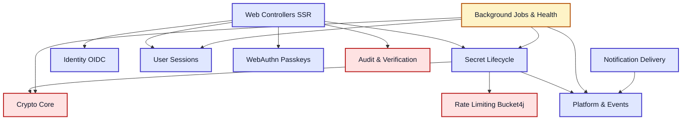
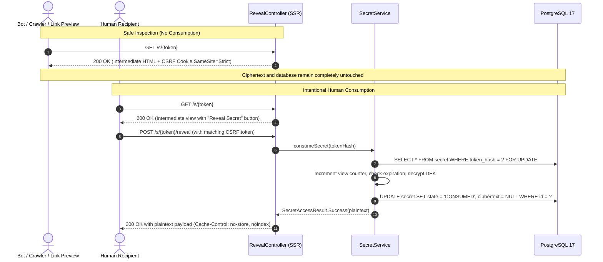
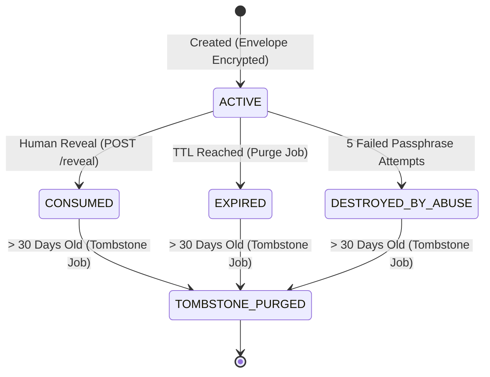

# 🔥 BurnBox

> **Production-grade ephemeral secret sharing with defense-in-depth security, cryptographic audit chaining, and automated background hygiene.**

[](https://openjdk.org/projects/jdk/25/)
[](https://spring.io/projects/spring-boot)
[](https://www.postgresql.org/)
[](src/test/java/com/burnbox/)
[](https://github.com/CharlyZeta/SDD-GL)
[](LICENSE)

[ **English** ] | [ **Español** ](README.es.md)

---

## ⚡ BurnBox in 30 Seconds

BurnBox is a self-destructing secret sharing web application for credentials, API tokens, and private keys. Senders authenticate via Google or Microsoft OIDC (or create anonymously), enter a sensitive payload, select expiration (5m to 7d) and maximum views (1 to 10), and generate a unique single-use link. When the recipient accesses it, the secret is revealed and its encrypted payload is immediately wiped from the database.

Unlike simple pastebins or Privnote clones, BurnBox is engineered with defense-in-depth enterprise security: **AES-256-GCM envelope encryption**, **Argon2id passphrases**, **WebAuthn FIDO2 passkeys**, a **tamper-evident SHA-256 cryptographic audit chain**, **distributed ShedLock hygiene jobs**, and **background KEK key rotation**. Built with **Java 25 LTS** and **Spring Boot 3.5**.

---

## 🎯 What Problem Does It Solve?

1. **Eliminates credential leaks in corporate communication:** Sharing passwords, API keys, or certificates over Slack, Microsoft Teams, or email permanently records plain text in cloud backups, indexing pipelines, and mobile notification logs.
2. **Guarantees zero residual persistence:** BurnBox ensures the secret payload exists only until consumed or expired, after which its ciphertext, nonce, and decryption keys are permanently overwritten with `NULL` in the database.
3. **Provides provable compliance and access control:** Senders can restrict access strictly to a verified recipient email, protect secrets with secondary Argon2id passphrases, and verify access integrity through a cryptographically chained audit log.

---

## 💼 Demonstrated Engineering Capabilities

| Capability | Engineering Highlights | Code Reference |
|---|---|---|
| **Defensive Security** | AES-256-GCM envelope encryption, Argon2id KDF, anti-nOAuth account hijack prevention, WebAuthn passkey quarantine, cryptographic audit ledger, uniform anti-enumeration responses. | [`com.burnbox.crypto`](src/main/java/com/burnbox/crypto/), [`com.burnbox.audit`](src/main/java/com/burnbox/audit/) |
| **Backend & Architecture** | Spring Modulith strict package slices, pure SQL with Spring Data `JdbcClient` (zero JPA dirty tracking), PostgreSQL 17 `SKIP LOCKED` concurrency, Java 25 `ScopedValue`. | [`com.burnbox.secret`](src/main/java/com/burnbox/secret/), [`ArchitectureTest`](src/test/java/com/burnbox/ArchitectureTest.java) |
| **Testing & Quality** | 198 automated tests, ArchUnit architectural enforcement, WebMvc and SpringBootTest slices, zero flaky tests, 100% First-Pass Quality Rate across 18 contracts. | [`src/test/java/com/burnbox`](src/test/java/com/burnbox/) |
| **Operations & Resilience** | ShedLock distributed coordination, background KEK rotation without downtime, automated tombstone and session hygiene jobs, custom Actuator health indicators without PII leakage. | [`com.burnbox.ops`](src/main/java/com/burnbox/ops/) |

---

## 📊 Real Project Status: Implemented vs Roadmap

We believe in complete technical transparency:

### ✅ Production-Ready & Verified (18 Contracts Resolved · 198 Tests)
- **Core Crypto:** 256-bit SecureRandom tokens, SHA-256 token hashing, AES-256-GCM encryption with 96-bit nonces, AAD authentication tags, RFC 3394 AESWrap KEK envelope ([`FEAT-0002`](contracts/FEAT-0002.md)).
- **Secret Lifecycle:** Pessimistic locking (`FOR UPDATE`), atomic consumption, instant ciphertext zeroing on terminal states ([`FEAT-0004`](contracts/FEAT-0004.md)).
- **Safe Reveal Web Flow:** Two-step `GET /s/{token}` intermediate view (immune to Slackbot/crawler consumption) and `POST /s/{token}/reveal` with anonymous double-submit CSRF cookie ([`FEAT-0005`](contracts/FEAT-0005.md)).
- **Web Creation SSR:** Validated payload limits (up to 64 KiB), strict expiration selectors, view limits, clean DOM output ([`FEAT-0006`](contracts/FEAT-0006.md)).
- **Abuse Protection:** Dual in-memory Bucket4j rate limiters (IP /24-/64 subnets & token buckets), 1-hour automatic IP quarantine after 10 failed token attempts ([`FEAT-0007`](contracts/FEAT-0007.md)).
- **Passphrase Protection:** Argon2id (19 MiB, 3 iterations, 1 parallelism, 16-byte random salt), DEK double-wrapping, 5-attempt brute-force self-destruction ([`FEAT-0008`](contracts/FEAT-0008.md)).
- **Google & Microsoft OIDC:** Atomic JIT provisioning, immutable `(issuer, sub)` binding, anti-nOAuth auto-merge blocking on unverified emails, dynamic Microsoft multi-tenant tenant validation ([`FEAT-0009`](contracts/FEAT-0009.md), [`FEAT-0010`](contracts/FEAT-0010.md)).
- **Session Management:** Metadata persistence in `user_session_meta`, dual timeout (30m idle, 12h absolute), single and bulk session revocation ([`FEAT-0011`](contracts/FEAT-0011.md)).
- **WebAuthn FIDO2 Passkeys:** 24-hour quarantine on initial passkey to mitigate session hijacking, `sign_count` clone detection, credential management ([`FEAT-0012`](contracts/FEAT-0012.md)).
- **Transactional Notifications:** Idempotent email queueing (`UNIQUE(source_event_id, template, user_id)`), zero sensitive data in email bodies, exponential backoff with dead-letter status ([`FEAT-0013`](contracts/FEAT-0013.md)).
- **Restricted Recipient:** OIDC identity verification, RFC 5322 email validation, uniform `NotAvailable` indistinguishability for unauthorized users ([`FEAT-0014`](contracts/FEAT-0014.md)).
- **Cryptographic Audit Chain:** Merkle-style SHA-256 hash chaining with `UNIQUE(prev_hash)`, PostgreSQL append-only triggers, user-facing audit verification ([`FEAT-0015`](contracts/FEAT-0015.md)).
- **Background Hygiene:** ShedLock distributed locks, 500-row `SKIP LOCKED` batch jobs for expired secret purging, 30-day tombstone cleanup, session pruning ([`FEAT-0016`](contracts/FEAT-0016.md)).
- **KEK Key Rotation:** Graceful `DECRYPT_ONLY` migration, online batch DEK re-wrapping without modifying ciphertext or nonces, immediate DEK memory zeroing ([`FEAT-0017`](contracts/FEAT-0017.md)).
- **Observabilidad & Health:** Custom `KeyHealthIndicator` and `JobRunHealthIndicator` on isolated management port 8081 without secret leakage ([`FEAT-0018`](contracts/FEAT-0018.md)).

### 🗺️ Future Roadmap (Stage 2)
- [ ] **Client-Side Zero-Knowledge Mode:** WebCrypto browser-side encryption so the server never receives plaintext even momentarily.
- [ ] **Cloud KMS Adapters:** AWS KMS, Google Cloud KMS, and HashiCorp Vault pluggable key providers.
- [ ] **CLI Client:** Native `burnbox` CLI for pipe-based terminal secret sharing (`echo "token" | burnbox share`).
- [ ] **WORM Audit Export:** Automated export of SHA-256 audit batches to Amazon S3 Glacier Object Lock or cloud immutable storage.

---

## 🚀 Quick Start (Up in 4 Commands)

### Prerequisites
- **Java 25 LTS**
- **Docker Compose**

### 1. Clone & start local infrastructure (PostgreSQL 17 & Mailpit)
```bash
git clone https://github.com/CharlyZeta/BurnBox.git && cd BurnBox
docker compose up -d
```

### 2. Run the automated test suite
```bash
./mvnw test
```

### 3. Start the application
```bash
./mvnw spring-boot:run
```

- **Web Application:** `http://localhost:8080`
- **Mailpit Web UI (Transactional Emails):** `http://localhost:8025`
- **Actuator Health & Metrics (Isolated Port):** `http://localhost:8081/actuator/health`

> [!TIP]
> For setting up Google and Microsoft OAuth credentials in development or production, see the **[OAuth Setup Guide](docs/oauth-setup.md)**. Anonymous secret creation and consumption works out of the box without any OAuth configuration.

---

## 🛠️ Tech Stack & Architectural Rationale

| Technology | Selection Rationale |
|---|---|
| **Java 25 LTS** | Leverages `ScopedValue` for lightweight, immutable request security contexts; native Virtual Threads readiness; modern pattern matching for domain modeling. |
| **Spring Boot 3.5.3** | Mature production runtime, streamlined Actuator observability, built-in security starters, and native Docker Compose support. |
| **Spring Modulith 1.4.1** | Enforces clean architectural boundaries across domain slices with automated verification, preventing cyclic coupling between modules. |
| **PostgreSQL 17** | Robust relational model, `FOR UPDATE SKIP LOCKED` for non-blocking high-throughput concurrency in jobs, JSONB capabilities, and append-only trigger enforcement. |
| **Pure SQL with `JdbcClient`** | Completely avoids JPA/Hibernate. Zero dirty-checking surprises, zero N+1 queries, zero accidental entity updates, explicit SQL control over every query. |
| **Flyway** | Deterministic forward-only database schema migrations versioned directly alongside code (V1 to V9). |
| **Argon2id** | OWASP and NIST recommended memory-hard password derivation function against GPU/ASIC cracking (19 MiB RAM, 3 iterations, 1 parallelism). |
| **ShedLock 6.2.0** | Distributed coordination for scheduled background jobs across multiple application instances without requiring Redis or ZooKeeper. |

---

## 🏗️ Architecture & Core Flows

### Module Architecture (Spring Modulith)



### Safe Reveal Flow (FEAT-0005)

Standard web crawlers, chat preview scrapers (Slack, Teams, Discord), and antivirus bots aggressively perform `GET` requests on links found in messages. If `GET` consumes the secret, the legitimate user receives a broken, already-destroyed link.

BurnBox guarantees that `GET` is strictly idempotent and safe:



---

## 🛡️ Highlighted Security Decisions

### 1. Safe GET Operation (Crawler Immunity)
`GET /s/{token}` renders a clean intermediate landing page without consuming the secret or touching its ciphertext. Consumption occurs exclusively via `POST /s/{token}/reveal` protected by an anonymous double-submit CSRF cookie (`SameSite=Strict`).

### 2. Envelope Encryption (AES-256-GCM + AESWrap)
Every secret generates a unique 256-bit Data Encryption Key (DEK). The payload is encrypted with AES-256-GCM using a 96-bit nonce and secret ID authentication tag. The DEK is then wrapped using an active Key Encryption Key (KEK) via RFC 3394 AESWrap. Plaintext and raw DEK arrays are immediately zeroed in memory after use.

### 3. Anti-nOAuth & Account Takeover Defense
BurnBox prevents account hijacking attacks caused by unverified OIDC emails. Accounts are strictly keyed by immutable `(issuer, sub)`. Auto-merging different OAuth providers based solely on matching emails is explicitly blocked unless verified through re-authentication.

### 4. WebAuthn Passkeys with Quarantine & Clone Anomaly Detection
When a user enrolls their initial Passkey, a 24-hour quarantine window (`PENDING_ACTIVATION`) is enforced to prevent attacker persistence during an active session hijack. Authenticator cloning is actively detected on every assertion by validating non-decreasing WebAuthn `sign_count` counters.

### 5. Cryptographic SHA-256 Audit Chain
Every security-relevant event (creation, access, denial, revocation, key rotation) is deterministically hashed with SHA-256 and linked to the preceding event's hash (`prev_hash`). An append-only PostgreSQL database trigger strictly forbids updates or deletions. Mathematical chain integrity can be verified on-demand by users and operators.

### 6. Uniform Anti-Enumeration Responses
When a secret does not exist, has already been consumed, expired, or belongs to a restricted email recipient that does not match the active session, BurnBox returns an identical, indistinguishable `reveal-unavailable.html` view. This completely eliminates timing attacks and secret enumeration.

---

## 🧪 Testing & Quality Assurance

BurnBox maintains a rigorous multi-layer test suite verified on every change:

- **198 Automated Tests:** Unit tests, integration tests, MVC controllers, and security filters.
- **Zero Failures, Zero Errors:** 100% pass rate.
- **ArchUnit Architectural Rules ([`ArchitectureTest.java`](src/test/java/com/burnbox/ArchitectureTest.java)):**
  - **No `Instant.now()` outside `ClockConfig`:** Prevents non-deterministic time bugs; all timestamps originate from an injected `Clock` bean.
  - **No JPA/Hibernate:** Strictly enforces direct, explicit SQL via `JdbcClient`.
  - **No `javax.crypto` outside `com.burnbox.crypto`:** Isolates cryptographic operations to a single audited module.
  - **No unescaped HTML:** Prohibits `th:utext` across all Thymeleaf templates to eliminate Cross-Site Scripting (XSS).

To run the full suite:
```bash
./mvnw test
```

---

## ⚙️ Configuration & Environment Variables

| Variable | Default Value | Description |
|---|---|---|
| `SPRING_DATASOURCE_URL` | `jdbc:postgresql://localhost:5432/burnbox` | PostgreSQL connection JDBC URL. |
| `SPRING_DATASOURCE_USERNAME` | `burnbox` | Database username. |
| `SPRING_DATASOURCE_PASSWORD` | `burnbox` | Database password. |
| `BURNBOX_IP_HASH_SALT` | *built-in dev salt* | HMAC-SHA256 salt for anonymizing IP addresses in logs. |
| `BURNBOX_KEK_V1` | *built-in dev key* | Base64-encoded 256-bit Key Encryption Key (KEK) for envelope encryption. |
| `SPRING_MAIL_HOST` | `localhost` | SMTP server host (Mailpit in development). |
| `SPRING_MAIL_PORT` | `1025` | SMTP server port. |
| `SPRING_SECURITY_OAUTH2_CLIENT_REGISTRATION_GOOGLE_CLIENT_ID` | *optional* | Google Cloud OAuth 2.0 Client ID. |
| `SPRING_SECURITY_OAUTH2_CLIENT_REGISTRATION_GOOGLE_CLIENT_SECRET` | *optional* | Google Cloud OAuth 2.0 Client Secret. |
| `SPRING_SECURITY_OAUTH2_CLIENT_REGISTRATION_MICROSOFT_CLIENT_ID` | *optional* | Microsoft Azure AD App Client ID. |
| `SPRING_SECURITY_OAUTH2_CLIENT_REGISTRATION_MICROSOFT_CLIENT_SECRET` | *optional* | Microsoft Azure AD App Client Secret. |

### Application Profiles
- `default`: Standard development profile with PostgreSQL and Mailpit.
- `test`: Automated testing profile using in-memory configurations and mock providers.
- `demo`: Standalone demonstration profile with mock OAuth fixtures.

---

## 🏛️ Deep Architectural Details (For Architects)

<details>
<summary><strong>📐 1. Architectural Modularity & Verification</strong></summary>

BurnBox is structured into bounded domain modules adhering to **Spring Modulith** standards:

- `com.burnbox.crypto`: Low-level cryptographic primitives (AES-GCM, Argon2id, AESWrap). Exclusively exports byte arrays; internal crypto classes are package-private.
- `com.burnbox.secret`: Core secret domain entity, state machine, and persistence.
- `com.burnbox.identity`: OIDC user provisioning and identity federation.
- `com.burnbox.session`: Session tracking, idle timeout enforcement, and remote revocation.
- `com.burnbox.passkey`: FIDO2 WebAuthn credential management and counter verification.
- `com.burnbox.notification`: Idempotent transactional email delivery with exponential backoff.
- `com.burnbox.audit`: SHA-256 cryptographic hash chain and user-facing event log.
- `com.burnbox.ops`: Background maintenance jobs (ShedLock, expired purge, tombstone cleanup, KEK rotation, health indicators).
- `com.burnbox.ratelimit`: Token bucket rate limiting (Bucket4j) and IP subnet normalization.
- `com.burnbox.platform`: Cross-cutting concerns (Clock injection, ScopedValue security contexts, event publishers).

Modularity rules are automatically verified during `./mvnw test` via [`ModularityTest.java`](src/test/java/com/burnbox/ModularityTest.java).
</details>

<details>
<summary><strong>📋 2. Architectural Decision Records (ADRs)</strong></summary>

| Decision | Discarded Alternative | Rationale & Trade-off |
|---|---|---|
| **Pure SQL with `JdbcClient`** | Spring Data JPA / Hibernate | Eliminates ORM dirty-checking vulnerabilities, lazy-loading N+1 regressions, and accidental updates of sensitive columns. *Trade-off: Requires writing explicit SQL statements.* |
| **Pessimistic Locking (`FOR UPDATE`)** | Optimistic Locking (`@Version`) | Eliminates race conditions during secret consumption. Two concurrent requests to reveal the same secret can never both succeed. *Trade-off: Requires holding a row lock for a few milliseconds.* |
| **In-Memory Rate Limiting (Bucket4j)** | Redis Distributed Rate Limiter | Drastically reduces operational complexity and external infrastructure dependencies for single-node or sticky-session deployments. *Trade-off: Subnet quotas are tracked per-instance.* |
| **ShedLock on PostgreSQL** | Quartz Scheduler / Redis Locks | Leverages existing PostgreSQL ACID guarantees for distributed leader election without introducing extra cluster dependencies. *Trade-off: Small table updates on cron ticks.* |
| **PostgreSQL Append-Only Trigger** | Immutable DB / Blockchain | Enforces cryptographic audit chain immutability natively in the database engine without external distributed ledger overhead. *Trade-off: Superusers with table drop privileges could bypass triggers.* |
| **Argon2id for Passphrases** | PBKDF2 / BCrypt | Argon2id is memory-hard and provides superior resistance against ASIC and GPU cluster cracking. *Trade-off: Consumes ~19 MiB RAM per active derivation.* |
</details>

<details>
<summary><strong>🎯 3. Threat Model & Mitigation Matrix</strong></summary>

| Threat | Attacker Goal | Mitigation in BurnBox | Verifying Automated Test |
|---|---|---|---|
| **Link Preview Secret Sniffing** | Crawler reads secret automatically from chat preview. | `GET` request is strictly read-only; consumption requires `POST` with CSRF cookie. | `RevealControllerTest.getIntermediatePageDoesNotConsumeSecret` |
| **Secret Enumeration / Probing** | Attacker brute-forces 43-character token URLs. | 256 bits of entropy ($2^{256}$ space) + 429 Rate Limiting + uniform `reveal-unavailable` responses. | `RevealControllerTest.nonExistentSecretRendersUniformUnavailableView` |
| **Passphrase Brute Force** | Attacker repeatedly guesses password on protected secret. | Counter limited to 5 attempts; permanent self-destruction (`DESTROYED_BY_ABUSE`) on 5th failure. | `PassphraseProtectionTest.fifthFailedAttemptPermanentlyDestroysSecret` |
| **nOAuth Identity Spoofing** | Attacker registers unverified email on IdP to take over existing account. | Mandatory `email_verified == true` assertion; dynamic tenant issuer validation. | `MicrosoftIssuerValidatorTest.rejectsUntrustedTenant` |
| **Authenticator Cloning** | Attacker extracts passkey private key and clones token. | Replay protection validating non-decreasing WebAuthn `sign_count`. | `PasskeyServiceTest.detectsClonedAuthenticator` |
| **Audit Ledger Tampering** | Attacker modifies past event records in database. | SHA-256 hash chaining + database append-only trigger + mathematical chain verifier. | `AuditChainVerifierTest.detectsTamperedEventData` |
</details>

<details>
<summary><strong>🔄 4. Data Lifecycle, Hygiene & KEK Key Rotation</strong></summary>



- **Atomic Content Zeroing:** The instant a secret transitions to `CONSUMED`, `EXPIRED`, or `DESTROYED_BY_ABUSE`, its `ciphertext`, `nonce`, `wrapped_dek`, `passphrase_salt`, and `recipient_email` are permanently overwritten with `NULL`.
- **30-Day Retention Grace Period:** Non-sensitive metadata (creation timestamp, creator user ID, consumption timestamp) is retained as a tombstone for 30 days for author auditing before permanent deletion by `TombstoneCleanupJob`.
- **Zero-Downtime KEK Rotation:** `KeyReEnvelopeJob` migrates active secrets from older KEK versions to the current active KEK using batches of 500 with `SKIP LOCKED`. Old KEKs remain in `DECRYPT_ONLY` mode during migration to prevent read interruptions.
</details>

<details>
<summary><strong>⚖️ 5. Honest Technical Boundaries & Design Constraints</strong></summary>

- **Audit Tamper Detection vs Tamper Prevention:** The SHA-256 hash chain and PostgreSQL trigger make unauthorized event tampering mathematically detectable by anyone with read access. However, a PostgreSQL superuser with direct root access could theoretically disable triggers and recalculate hashes. In Stage 2, cryptographic audit receipts will be periodically anchored to cloud WORM storage.
- **Server-Side Envelope vs Client-Side Zero-Knowledge:** In the current implementation, the server briefly holds the unencrypted secret in transient memory during `POST /secrets` before encrypting and zeroing memory. For applications requiring zero-trust in the server host, client-side WebCrypto encryption is planned for Stage 2.
</details>

---

## 📁 Repository Structure

```
burnbox/
├── contracts/               # SDD-GL specification contracts (FEAT-0001 to FEAT-0018)
├── protocol/                # SDD-GL methodology protocols (contract, gate, loop)
├── docs/                    # Technical documentation and guides
│   └── oauth-setup.md       # OAuth 2.0 configuration guide
├── src/
│   ├── main/
│   │   ├── java/com/burnbox/
│   │   │   ├── audit/       # Cryptographic audit hash chain & verification
│   │   │   ├── crypto/      # Envelope encryption (AES-256-GCM, Argon2id, AESWrap)
│   │   │   ├── identity/    # OIDC authentication (Google, Microsoft dynamic tenant)
│   │   │   ├── notification/# Transactional email delivery with idempotency
│   │   │   ├── ops/         # Scheduled jobs (ShedLock, purge, KEK rotation, health)
│   │   │   ├── passkey/     # WebAuthn FIDO2 passkeys with quarantine
│   │   │   ├── platform/    # Architecture primitives, ScopedValue, Clock injection
│   │   │   ├── ratelimit/   # In-memory Bucket4j abuse protection
│   │   │   ├── secret/      # Secret domain, lifecycle state machine, SSR controllers
│   │   │   └── session/     # User session metadata & remote revocation
│   │   └── resources/
│   │       ├── db/migration/# Flyway forward migrations (V1 to V9)
│   │       ├── templates/   # Thymeleaf SSR views without th:utext
│   │       └── application.yaml
│   └── test/java/com/burnbox/ # 198 automated unit, integration, and arch tests
├── compose.yaml             # Local PostgreSQL 17 & Mailpit setup
├── CONSTITUTION.md          # 12 inviolable architectural principles
├── SECURITY.md              # Vulnerability disclosure policy
└── pom.xml                  # Maven dependencies & build configuration
```

---

## 🎯 Built with SDD-GL (Spec-Driven Development with Guarded Loops)

BurnBox was engineered using **[SDD-GL v0.6.4](https://github.com/CharlyZeta/SDD-GL)**, an advanced spec-driven software engineering methodology:

- **Gate Protocol (Pre-Implementation Rigor):** Every feature starts as a formal specification contract (`contracts/FEAT-XXXX.md`) bounded by strict size budgets ($\le$ 7 Business Rules, $\le$ 8 Acceptance Criteria, $\le$ 5 Alternative Flows) and must achieve a `READY_FOR_APPROVAL` verdict before any code is written.
- **Loop Protocol (Multi-Layer Verification):** Implementation proceeds item-by-item across 4 mandatory verification layers:
  1. `functional`: Unit and integration test assertions.
  2. `static`: Compiler checks and static code quality.
  3. `security`: Threat mitigations and PII leakage prevention.
  4. `arch`: Architectural rules enforced via ArchUnit.
- **First-Pass Quality Rate (FPQR):** **100% across all 18 contracts** (339 recorded steps without implementation backtracking or broken specs).

Every specification contract, acceptance criteria, and execution log is fully preserved in [`contracts/`](contracts/).

---

## 📄 License & Contact

Distributed under the **MIT License**. See `LICENSE` for details.

- **Author:** Gerardo Maidana
- **GitHub:** [@CharlyZeta](https://github.com/CharlyZeta)
- **Repository:** [https://github.com/CharlyZeta/BurnBox](https://github.com/CharlyZeta/BurnBox)
