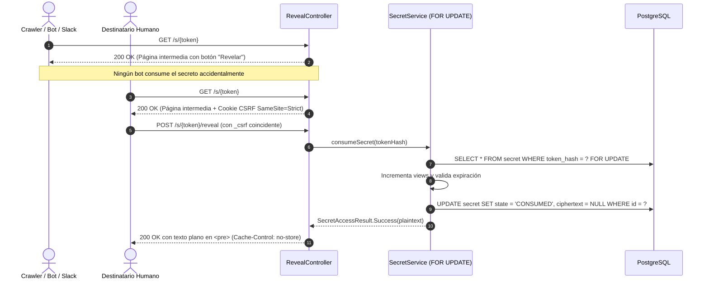

# 🔥 Burnbox

> **Servicio de secretos efímeros de alta seguridad** con destrucción garantizada, arquitectura hexagonal basada en **Spring Modulith**, **Java 25 LTS** y desarrollado mediante metodología **SDD-GL (Specification-Driven Development con Gate y Loop)**.

[](https://openjdk.org/projects/jdk/25/)
[](https://spring.io/projects/spring-boot)
[](https://spring.io/projects/spring-modulith)
[](https://github.com/CharlyZeta/SDD-GL)
[](#metodología-sdd-gl)

---

## 🏛️ Principios Constitucionales (`CONSTITUTION.md`)

El desarrollo se rige por 12 invariantes inquebrantables verificadas automáticamente en CI mediante **ArchUnit** y tests no funcionales:

1. **Aislamiento criptográfico total:** Todo uso de `javax.crypto` reside estrictamente dentro de `com.burnbox.crypto`. Ningún otro paquete puede importarlo.
2. **Sin JPA / Hibernate:** Persistencia exclusiva mediante SQL explícito con `JdbcClient` y Spring Data JDBC.
3. **Control del tiempo:** Todo acceso temporal utiliza exclusivamente la instancia inyectada de `java.time.Clock`. Prohibido `Instant.now()`, `LocalDateTime.now()` o `Thread.sleep`.
4. **Cero secretos en logs ni auditoría:** Prohibido registrar tokens en claro, contenido, passphrases, ciphertext o cabeceras `Cookie`/`Authorization`.
5. **Cero `th:utext`:** Todo renderizado SSR de contenido escapa caracteres vía `th:text` dentro de `<pre>`.
6. **Fronteras Modulith:** Los módulos se comunican exclusivamente por eventos de dominio o puertos declarados; `ApplicationModules.verify()` valida las dependencias cíclicas en cada compilación.
7. **Consumo atómico bajo concurrencia:** Lectura y consumo de secretos protegidos mediante `SELECT ... FOR UPDATE` a nivel de motor relacional.
8. **Indistinguibilidad anónima:** Toda respuesta a un recurso no disponible (inexistente, vencido o consumido) devuelve un código y contenido uniforme e idéntico para evitar enumeración.

---

## 📦 Mapa de Módulos (Spring Modulith)

```
com.burnbox
├── platform         # Reloj, seguridad HTTP, contexto Scoped Values, publicación de eventos
├── crypto           # Tokens de 256 bits, AES-256-GCM con AAD, envelope y KeyProvider
├── secret           # Dominio del secreto, máquina de estados, repositorio FOR UPDATE y controller SSR
├── audit            # Registro append-only de eventos de seguridad con HMAC de IP
├── ratelimit        # Rate limiting y contramedidas de abuso (FEAT-0007)
├── identity         # Autenticación OIDC federada, mitigación nOAuth, provisión de identidades (FEAT-0009, FEAT-0010)
├── session          # Sesiones de usuario concurrentes, expiración dual (30m/12h) y revocación (FEAT-0011)
├── passkey          # Credenciales WebAuthn / FIDO2, cuarentena de 24h y detección de clones (FEAT-0012)
├── notification     # Notificaciones transaccionales por email con idempotencia y reintentos (FEAT-0013)
└── ops              # Endpoints operativos y rotación de claves (próximo)
```

---

## 🚀 Registro de Features y Fixes Resueltos (SDD-GL)

| Contrato | Tipo | Estado | Progreso | Descripción técnica |
| :--- | :--- | :--- | :--- | :--- |
| [`FEAT-0001`](contracts/FEAT-0001.md) | Feature | **RESOLVED** | 22/22 ✅ | Esqueleto base: Boot 3.5, Java 25, Modulith, Flyway, Compose con PostgreSQL 17 y Mailpit, Clock inyectado, cabeceras HTTP de seguridad. |
| [`FEAT-0002`](contracts/FEAT-0002.md) | Feature | **RESOLVED** | 23/23 ✅ | Núcleo criptográfico: token de 32 bytes `SecureRandom` (43 chars base64url), SHA-256 hex, envelope AES-256-GCM con 96-bit nonce, AAD `secretId:keyVersion:formatVersion`, `LocalKeyProvider` con AESWrap RFC 3394/5649. |
| [`FEAT-0003`](contracts/FEAT-0003.md) | Feature | **RESOLVED** | 22/22 ✅ | Contexto con `ScopedValue` de Java 25, puerto `SecurityEventPublisher`, `HmacIpHasher`, logging estructurado ECS JSON, test canario de detección de fugas, persistencia en `security_event`. |
| [`FEAT-0004`](contracts/FEAT-0004.md) | Feature | **RESOLVED** | 24/24 ✅ | Ciclo de vida del secreto: `SecretState` (`ACTIVE`, `CONSUMED`, `EXPIRED`, etc.), consumo atómico pesimista con `SELECT ... FOR UPDATE`, vaciado inmediato de ciphertext en estados terminales, eventos de dominio. |
| [`FEAT-0005`](contracts/FEAT-0005.md) | Feature | **RESOLVED** | 24/24 ✅ | Revelado anónimo SSR: página intermedia `GET /s/{token}` inmune a crawlers, `POST /s/{token}/reveal` con CSRF por doble envío anónimo (`SameSite=Strict`), respuesta directa sin PRG, respuesta uniforme para no disponibles, cabeceras `no-store` y `noindex`. |
| [`FEAT-0006`](contracts/FEAT-0006.md) | Feature | **RESOLVED** | 23/23 ✅ | Creación web de secretos SSR: formulario principal `GET /`, validación de carga útil estricta (máx 64 KiB), selector de vencimiento (5m, 1h, 1d, 7d) y límite de visitas (1..10), endpoint `POST /secrets`, presentación de link único con botón de copiado (`secret-created.html`) sin `th:utext`. |
| [`FEAT-0007`](contracts/FEAT-0007.md) | Feature | **RESOLVED** | 22/22 ✅ | Rate Limiting y Protección contra Abuso: buckets Bucket4j en memoria (`reveal-ip` 20/min, `reveal-token` 10/min, `create-ip` 30/h), normalización IPv4 /24 e IPv6 /64, respuesta uniforme 429 con cabecera `Retry-After`, bloqueo por abuso de 1 hora ante 10 fallos de token en 5 min, y emisión del evento `AbuseIpFlagged`. |
| [`FEAT-0008`](contracts/FEAT-0008.md) | Feature | **RESOLVED** | 22/22 ✅ | Secretos Protegidos por Passphrase (E3): KDF Argon2id con sal de 16 bytes y 19 MiB de memoria, semáforo de concurrencia acotado a 4 derivaciones, doble envoltura DEK (`passphraseKey` + KEK), pantalla SSR de contraseña con contador de intentos restantes, y autodestrucción atómica irreversible con emisión de `SecretDestroyedByAbuse` tras 5 fallos. |
| [`FEAT-0009`](contracts/FEAT-0009.md) | Feature | **RESOLVED** | 22/22 ✅ | Identidad y Autenticación OIDC con Google: provisión atómica de usuarios según sección 6, invariante unívoco `(issuer, sub)`, mitigación estricta de secuestro de cuenta nOAuth (bloqueo de auto-merge ante colisiones de email), máquina de estados (`ACTIVE`, `DISABLED`, `PENDING_DELETION`), logout seguro `POST /logout` y eventos de dominio tipados sin PII. |
| [`FEAT-0010`](contracts/FEAT-0010.md) | Feature | **RESOLVED** | 19/19 ✅ | Login con Microsoft y Validador Dinámico Multi-Tenant de Issuer: soporte para endpoint `common`, `MicrosoftIssuerValidator` con regex `^https://login\.microsoftonline\.com/({tid})/v2\.0$` y validación cruzada con el claim `tid`, verificación estricta de `email_verified == true` para prevenir vulnerabilidades de nOAuth / toma de cuentas preexistentes, y registro unívoco en `linked_identity`. |
| [`FEAT-0011`](contracts/FEAT-0011.md) | Feature | **RESOLVED** | 21/21 ✅ | Sesiones Gestionables: metadatos de sesión persistidos en `user_session_meta` (`JdbcClient`), política de expiración dual (30 min inactividad, 12 horas timeout absoluto), vista web SSR `/account/sessions` con IP ofuscada, revocación unitaria con verificación de autoría (`POST /account/sessions/{id}/revoke`), revocación masiva de sesiones remotas (`POST /account/sessions/revoke-others`) y eventos de auditoría `SessionCreated`, `SessionRevoked`, `SessionExpired`. |
| [`FEAT-0012`](contracts/FEAT-0012.md) | Feature | **RESOLVED** | 22/22 ✅ | Gestión de Passkeys WebAuthn (FIDO2): persistencia en `passkey_credential` (`JdbcClient`), cuarentena de 24 horas (`PENDING_ACTIVATION`) para el primer passkey contra secuestro de sesión, activación inmediata para passkeys subsiguientes, detección estricta de clonación de autenticador mediante verificación de `sign_count`, vista web SSR `/account/passkeys` y eventos `PasskeyEnrolled`, `PasskeyActivated`, `PasskeyRevoked`, `PasskeyCounterAnomaly`. |
| [`FEAT-0013`](contracts/FEAT-0013.md) | Feature | **RESOLVED** | 22/22 ✅ | Notificaciones Transaccionales por Email con Idempotencia y Reintentos (C-11): tabla `notification_delivery` con constraint unívoco `UNIQUE(source_event_id, template, user_id)`, envío asíncrono con `DefaultEmailSenderClient` hacia Mailpit, política de cero datos sensibles en el mensaje, reintentos con backoff exponencial (`next_retry_at`) y transición a `DEAD` tras 5 intentos fallidos, y eventos de auditoría `NotificationQueued`, `NotificationSent`, `NotificationFailed`, `NotificationDead`. |
| [`FEAT-0014`](contracts/FEAT-0014.md) | Feature | **RESOLVED** | 22/22 ✅ | Destinatario Restringido y Validación de Email (E4 / C-14): restricción de acceso exclusiva a un email de destinatario verificado, validación RFC 5322 en creación `POST /secrets`, exigencia de login OIDC `reveal-login-required` para anónimos, verificación estricta de `email_verified == true` coincidente (case-insensitive), respuesta uniforme indistinguible `reveal-unavailable` ante usuarios no autorizados (anti-enumeración), y emisión de auditoría `SecretAccessDenied` con cero PII en `details`. |

---

## 🛡️ Flujo de Revelado de Secretos (FEAT-0005)



---

## 🛠️ Ejecución y Pruebas

### Requisitos
- **Java 25 LTS**
- **Docker Compose** (para PostgreSQL y Mailpit)

### Levantar infraestructura local
```bash
docker compose up -d
```

### Ejecutar suite completa de tests (166 tests unitarios, de integración, arquitectura y seguridad)
```bash
./mvnw test
```

### Iniciar aplicación
```bash
./mvnw spring-boot:run
```

- **App:** `http://localhost:8080`
- **Actuator Health:** `http://localhost:8081/actuator/health`

---

## 📋 Metodología SDD-GL

El proyecto implementa estrictamente **SDD-GL v0.6.4**:
- **Gate Protocol:** Ninguna feature o corrección se implementa sin un contrato validado que cumpla los presupuestos atómicos (≤ 7 BR, ≤ 8 AC, ≤ 5 AF) y cuente con aprobación humana (`READY_FOR_APPROVAL` -> `APPROVED`).
- **Loop Protocol:** Implementación dirigida por el Completion Map de 4 capas (`functional`, `static`, `security`, `arch`), registrando evidencia ejecutable verificable.
- **Métricas:** Seguimiento en tiempo real de First-Pass Quality Rate (FPQR) y estabilidad del ledger.
