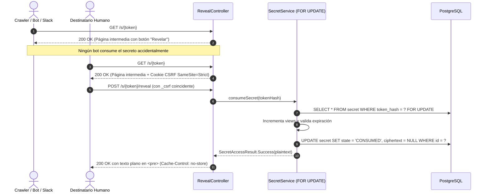

# 🔥 Burnbox

> **Servicio de secretos efímeros de alta seguridad** con destrucción garantizada, arquitectura hexagonal basada en **Spring Modulith**, **Java 25 LTS** y desarrollado mediante metodología **SDD-GL (Specification-Driven Development con Gate y Loop)**.

[](https://openjdk.org/projects/jdk/25/)
[](https://spring.io/projects/spring-boot)
[](https://spring.io/projects/spring-modulith)
[](https://github.com/CharlyZeta/SDD-GL)
[](#metodología-sdd-gl)

---

## 🏛️ Principios Constitucionales (`CONSTITUTION.md`)

El desarrollo se rige por 12 invariantes inquebrantables verificadas automáticamente en CI mediante **ArchUnit** y tests no funcionales:

1. **Aislamiento criptográfico total:** Todo uso de `javax.crypto` reside estrictamente dentro de `com.burnbox.crypto`. Ningún otro paquete puede importarlo.
2. **Sin JPA / Hibernate:** Persistencia exclusiva mediante SQL explícito con `JdbcClient` y Spring Data JDBC.
3. **Control del tiempo:** Todo acceso temporal utiliza exclusivamente la instancia inyectada de `java.time.Clock`. Prohibido `Instant.now()`, `LocalDateTime.now()` o `Thread.sleep`.
4. **Cero secretos en logs ni auditoría:** Prohibido registrar tokens en claro, contenido, passphrases, ciphertext o cabeceras `Cookie`/`Authorization`.
5. **Cero `th:utext`:** Todo renderizado SSR de contenido escapa caracteres vía `th:text` dentro de `<pre>`.
6. **Fronteras Modulith:** Los módulos se comunican exclusivamente por eventos de dominio o puertos declarados; `ApplicationModules.verify()` valida las dependencias cíclicas en cada compilación.
7. **Consumo atómico bajo concurrencia:** Lectura y consumo de secretos protegidos mediante `SELECT ... FOR UPDATE` a nivel de motor relacional.
8. **Indistinguibilidad anónima:** Toda respuesta a un recurso no disponible (inexistente, vencido o consumido) devuelve un código y contenido uniforme e idéntico para evitar enumeración.

---

## 📦 Mapa de Módulos (Spring Modulith)

```
com.burnbox
├── platform         # Reloj, seguridad HTTP, contexto Scoped Values, publicación de eventos
├── crypto           # Tokens de 256 bits, AES-256-GCM con AAD, envelope y KeyProvider
├── secret           # Dominio del secreto, máquina de estados, repositorio FOR UPDATE y controller SSR
├── audit            # Registro append-only de eventos de seguridad con HMAC de IP
├── ratelimit        # Rate limiting y contramedidas de abuso (próximo)
├── session          # Sesiones JDBC anónimas y de usuario (próximo)
├── identity         # Autenticación OIDC y gestión de usuarios (próximo)
├── passkey          # Credenciales WebAuthn / FIDO2 (próximo)
├── notification     # Envío de notificaciones transaccionales vía Mailpit (próximo)
└── ops              # Endpoints operativos y rotación de claves (próximo)
```

---

## 🚀 Registro de Features y Fixes Resueltos (SDD-GL)

| Contrato | Tipo | Estado | Progreso | Descripción técnica |
| :--- | :--- | :--- | :--- | :--- |
| [`FEAT-0001`](contracts/FEAT-0001.md) | Feature | **RESOLVED** | 22/22 ✅ | Esqueleto base: Boot 3.5, Java 25, Modulith, Flyway, Compose con PostgreSQL 17 y Mailpit, Clock inyectado, cabeceras HTTP de seguridad. |
| [`FEAT-0002`](contracts/FEAT-0002.md) | Feature | **RESOLVED** | 23/23 ✅ | Núcleo criptográfico: token de 32 bytes `SecureRandom` (43 chars base64url), SHA-256 hex, envelope AES-256-GCM con 96-bit nonce, AAD `secretId:keyVersion:formatVersion`, `LocalKeyProvider` con AESWrap RFC 3394/5649. |
| [`FEAT-0003`](contracts/FEAT-0003.md) | Feature | **RESOLVED** | 22/22 ✅ | Contexto con `ScopedValue` de Java 25, puerto `SecurityEventPublisher`, `HmacIpHasher`, logging estructurado ECS JSON, test canario de detección de fugas, persistencia en `security_event`. |
| [`FEAT-0004`](contracts/FEAT-0004.md) | Feature | **RESOLVED** | 24/24 ✅ | Ciclo de vida del secreto: `SecretState` (`ACTIVE`, `CONSUMED`, `EXPIRED`, etc.), consumo atómico pesimista con `SELECT ... FOR UPDATE`, vaciado inmediato de ciphertext en estados terminales, eventos de dominio. |
| [`FEAT-0005`](contracts/FEAT-0005.md) | Feature | **RESOLVED** | 24/24 ✅ | Revelado anónimo SSR: página intermedia `GET /s/{token}` inmune a crawlers, `POST /s/{token}/reveal` con CSRF por doble envío anónimo (`SameSite=Strict`), respuesta directa sin PRG, respuesta uniforme para no disponibles, cabeceras `no-store` y `noindex`. |

---

## 🛡️ Flujo de Revelado de Secretos (FEAT-0005)



---

## 🛠️ Ejecución y Pruebas

### Requisitos
- **Java 25 LTS**
- **Docker Compose** (para PostgreSQL y Mailpit)

### Levantar infraestructura local
```bash
docker compose up -d
```

### Ejecutar suite completa de tests (53 tests unitarios, de arquitectura y seguridad)
```bash
./mvnw test
```

### Iniciar aplicación
```bash
./mvnw spring-boot:run
```

- **App:** `http://localhost:8080`
- **Actuator Health:** `http://localhost:8081/actuator/health`

---

## 📋 Metodología SDD-GL

El proyecto implementa estrictamente **SDD-GL v0.6.4**:
- **Gate Protocol:** Ninguna feature o corrección se implementa sin un contrato validado que cumpla los presupuestos atómicos (≤ 7 BR, ≤ 8 AC, ≤ 5 AF) y cuente con aprobación humana (`READY_FOR_APPROVAL` -> `APPROVED`).
- **Loop Protocol:** Implementación dirigida por el Completion Map de 4 capas (`functional`, `static`, `security`, `arch`), registrando evidencia ejecutable verificable.
- **Métricas:** Seguimiento en tiempo real de First-Pass Quality Rate (FPQR) y estabilidad del ledger.
